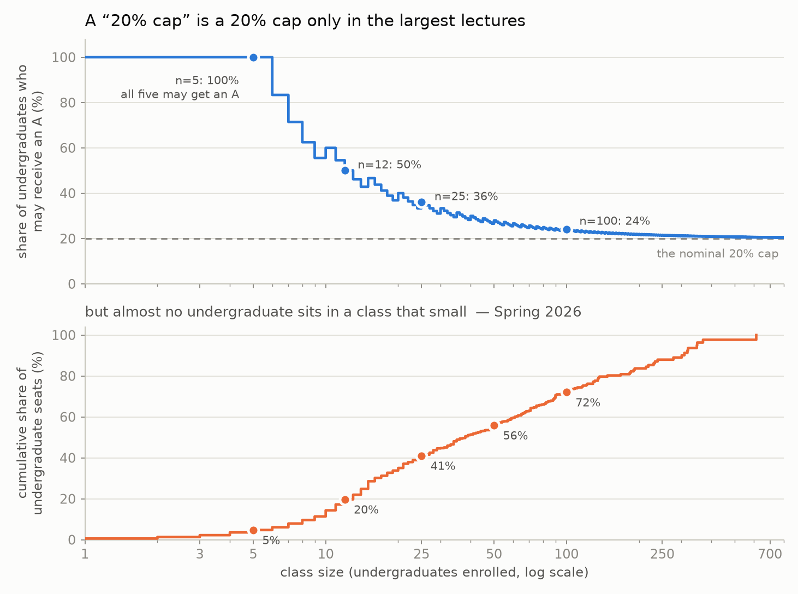

# Did Harvard's A-grade cap change what students enrol in?

A [Harvard Open Data Project](https://www.hodp.org/) analysis of FAS course-enrollment data, 2022–2026.

In May 2026 the FAS faculty adopted a **"20% + 4" cap on A grades** (in force from Fall 2027): instructors
may give A's to at most 20% of undergraduate enrollment plus four. Students floated many theories about how
classmates would respond — stacking Gen Eds, fleeing to small seminars or graduate courses, avoiding CS.
This project tests each one against registrar enrollment reports, using earlier year-pairs as a baseline
for what a "normal" year looks like.



## Findings

| Hypothesis | Verdict |
|---|---|
| Gen Ed stacking | Not supported — within ordinary year-to-year swings |
| Shift to small classes | Not supported — no bunching at the n ≤ 5 threshold where the cap stops binding |
| Taking harder courses | Mixed, weakly against |
| Fleeing to graduate courses | Contradicted |
| Avoiding CS | Real decline, but it started *before* the cap was public |
| Pre-med / iconic courses | Not a 2026 effect |

What did change: Psychology and Economics fell, Statistics, Government and Neuroscience grew, Math showed a
"barbell" (Math 22a −46%, Math 55a at a window high), and FAS offered 171 fewer sections. Applied to the real
class-size distribution, "20% + 4" permits roughly **37%** of undergraduate grades to be A's.

The full write-up, including the data pitfalls (misaligned snapshot dates, mid-window department renames,
Harvard's 1000-level undergraduate numbering), is in [`enrolment_cap_analysis.ipynb`](enrolment_cap_analysis.ipynb).

## Methods

- **Matched-course panel:** compare only courses that ran with undergraduates in both terms of a pair, so
  catalogue changes aren't mistaken for student behaviour.
- **Pre-trend benchmarks:** every 2025→26 change is read against the 2022→23, 2023→24 and 2024→25 changes.
- **Class-level threshold test:** checks whether classes bunch at the size where the cap stops binding.
- **Independent verification:** `verify.py` and `verify_small.py` recompute every headline number from the
  raw CSVs using only the standard library, sharing no code with the analysis.

## Files

| File | Purpose |
|---|---|
| `enrolment_cap_analysis.ipynb` | Main analysis and write-up |
| `enrollment_lib.py` | Loader, department-rename aliases, course taxonomy |
| `small_class_analysis.py`, `premed_analysis.py` | Follow-up analyses |
| `make_charts.py`, `make_charts_small.py` | Figures (`fig*.png`) |
| `verify.py`, `verify_small.py` | Independent re-computation of headline numbers |

## Data

The raw CSVs are not included. The 2022–24 reports come from the
[FAS Registrar enrollment-report archive](https://registrar.fas.harvard.edu/links/archive/enrollment-reports)
(converted from `.xlsx`). The 2025–26 files are the registrar's "Class Enrollment Summary by Term" report.
Place them as listed in `enrollment_lib.TERM_FILES`, then:

```bash
pip install -r requirements.txt
jupyter notebook enrolment_cap_analysis.ipynb
```
